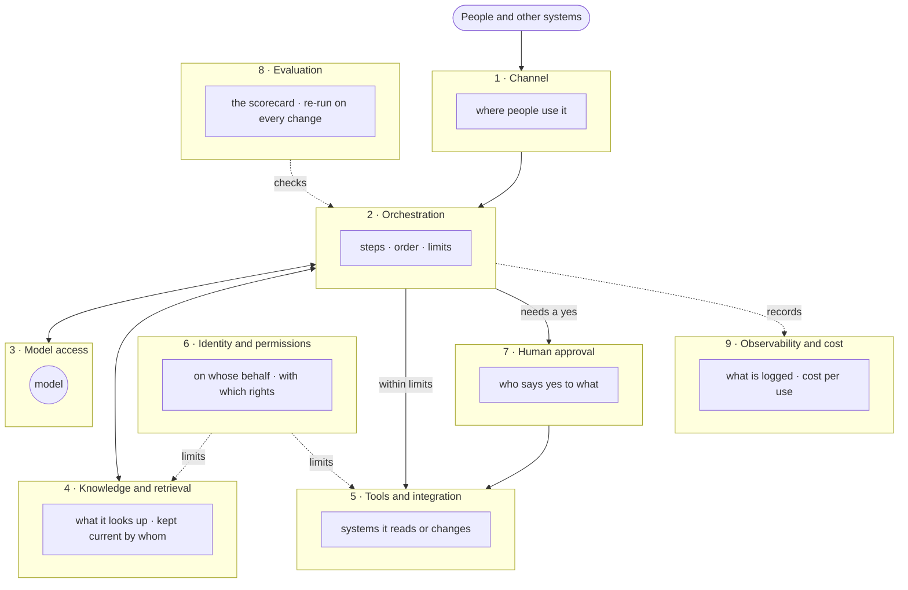

# Reference architecture — an AI system in nine layers

**Use it for:** drawing one AI use case on one page before anyone builds, and putting a name next to
every layer. Every blank owner is a question for this week.

**How to use it:** copy the diagram, draw your use case's flow across it, fill in the legend's
*Owner* column with a person's name (not a team), and name the pattern. Bring it to the first
design review, and to security and audit before they ask.

> This Markdown file is the source. The draw.io, PowerPoint and PDF versions are built from it.
> A filled-in example — an insurer's claims fast track — is in
> [`reference-architecture.claims.md`](./reference-architecture.claims.md).

## The picture

The model is one layer of nine. It is drawn small on purpose.

## The legend

| # | Layer | Question it answers | Usual owner | What goes wrong here | Ask |
|---|---|---|---|---|---|
| 1 | **Channel** | Where do people use it — chat, an existing application, a step in a process? | Owner of the application people already use | A new chat window nobody opens, because the work happens somewhere else | *"Where do people already do this work?"* |
| 2 | **Orchestration** | What steps does it take, in what order, with what limits? | The product team building the use case | No limit on steps or retries; no path for the case it cannot handle | *"What happens to a case it cannot handle?"* |
| 3 | **Model access** | Which models, through which gateway, under which data agreement? | Platform team | Each project its own key and contract; the data agreement does not cover the data actually sent | *"Does our agreement cover what we send it?"* |
| 4 | **Knowledge and retrieval** | What does it look up, from which sources, kept current by whom? | The business owner of the documents or records | Old or wrong versions; nobody keeps them current; it picks one, confidently | *"Which version does it read, and who keeps it current?"* |
| 5 | **Tools and integration** | Which systems can it read or change, through which interfaces (APIs, MCP)? | Owner of each system it touches | Undocumented interfaces; write access wider than the task needs | *"Which systems can it change, and where is that written down?"* |
| 6 | **Identity and permissions** | On whose behalf does it act, with which rights? | Security, identity and access management | A service account that can see and do everything; the limit written in the prompt instead of in the system | *"Where does the limit live — in the prompt, or in the system?"* |
| 7 | **Human approval** | Which actions need a person to say yes, and who? | The business owner of the use case | Nobody named; approval not recorded; approval becomes a rubber stamp | *"Who says yes, and what stops it becoming a rubber stamp?"* |
| 8 | **Evaluation** | How is quality measured, before go-live and on every change? | Product Owner owns the scorecard; engineering automates it | Decided on a demo; not re-run after a change of model, prompt, data or document | *"When was the scorecard last re-run, and on what change?"* |
| 9 | **Observability and cost** | What is logged, what does each use cost, who sees it? | Platform team runs it; the use-case owner reads it | Nobody can answer *"why did it do that?"*; the cost per use is known only from the invoice | *"If a customer complains, which record answers them?"* |

## Three patterns

Most first use cases are one of these. Each puts the risk in a different layer — name the pattern,
then spend the design effort there.

| Pattern | What it is | Where the risk sits | Example |
|---|---|---|---|
| **1 · Knowledge assistant** | Answers questions from your own documents | **4 Knowledge**, **6 Permissions** — the right version, and only what the asker may see | An assistant for staff over policies and procedures |
| **2 · Agent in a business process, with human approval** | Takes steps in your systems inside a fixed process; a person approves what matters | **5 Tools**, **6 Identity**, **7 Approval** — what it may change, as whom, and who says yes | Fast-tracking small claims (see the filled-in version) |
| **3 · AI-built software delivery** | AI writes the changes; people decide what to build and what goes live | **7 Approval**, **8 Evaluation** — who approves which version, checked how | Coding agents in a delivery team (Part 8) |

## Build controls once

Layers 3, 6 and 9 — model access, identity, logging — are best built once, in the platform, and
reused by every use case. Built once, they are reviewed once. Built per project, they are reviewed per
project, and review becomes the queue.

For your second use case, mark which layers it can reuse from the first. If the answer is *none*, the
first one was built as a project, not as a capability.

## Owners — fill in

| # | Layer | Owner (a name) | Shared with another use case? |
|---|---|---|---|
| 1 | Channel | | |
| 2 | Orchestration | | |
| 3 | Model access | | |
| 4 | Knowledge and retrieval | | |
| 5 | Tools and integration | | |
| 6 | Identity and permissions | | |
| 7 | Human approval | | |
| 8 | Evaluation | | |
| 9 | Observability and cost | | |

**Pattern:** ☐ 1 Knowledge assistant · ☐ 2 Agent in a process · ☐ 3 AI-built software

---

*AI Product Design, Part 4 · faridgurbanov.com · CC BY 4.0. Not a vendor architecture; tool-neutral
by design.*
